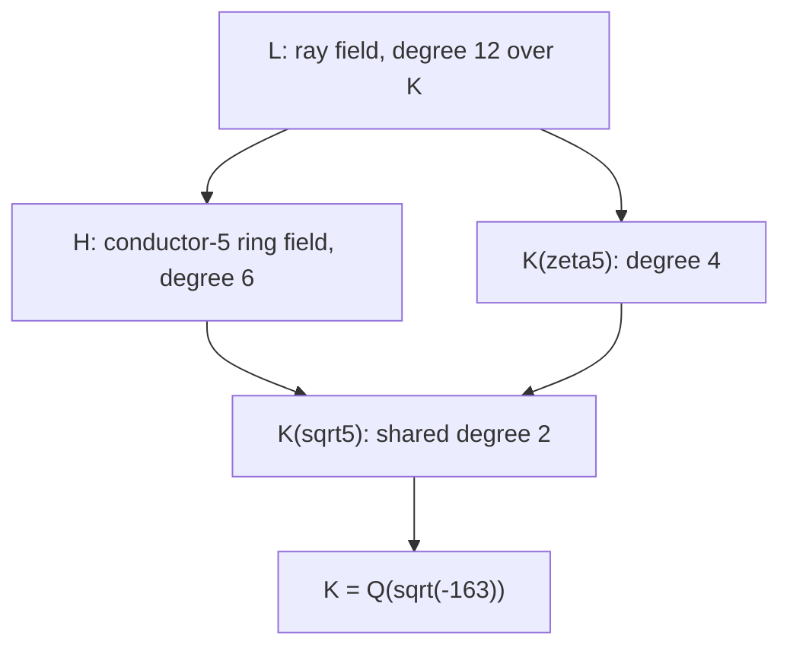

# Hermite's modular viewpoint: geometry and recoverable information

Date: 2026-10-19. This continuation asks for mathematical meaning, rather than
using novelty as the admission criterion. Established results remain valuable
when they identify what a coarse description hides. The statements below are
written deductions and exact finite certificates, with named classical inputs.
They do not assert a new cryptosystem or an attack on a deployed scheme.

## 1. What the original Hermite passage actually says

In the 1859 volume *Sur la theorie des equations modulaires et la resolution
de l'equation du cinquieme degre*, printed pp. 47-48 (PDF pp. 56-57), Hermite
passes from six lambda-type transforms to their symmetric invariant and relates
its equation degree to the number of classes. In the class-number-one case the
normalized invariant is integral. On printed p. 48 he uses the exponentially
small nome to explain proximity to an integer, explicitly mentioning -67 and
-163 and the twelve initial nines for the latter. This is direct primary
evidence for his discussion in 1859; an exhaustive historical priority claim
is unnecessary here.

Using modern notation R=exp(pi sqrt(163)), N=640320^3+744 and
q=exp(2 pi i tau)=-1/R, the familiar mechanism is

    j(tau)=-640320^3,
    j(q)=q^-1+744+196884 q+21493760 q^2+...,
    N-R=196884/R-21493760/R^2+... .

This is a geometric/arithmetic combination: the CM point gives an exact
integral modular value, while its height Im(tau)=sqrt(163)/2 makes q tiny.
The fixed number R has a fixed nonzero error, rather than a sequence that
converges to an integer. Changing the admissible discriminant or truncating the
series gives distinct notions of approximation.

Historical source fidelity matters: the original scan prints 196880 where the
modern first j coefficient is 196884. We retain that discrepancy. The new
checker independently derives the modern coefficient from E4^3/Delta; we do
not silently repair Hermite's printed text. His q on that page has square
equal to the modern nome q used above.

The volume's opening essay, printed pp. 1-2, explains a different important
point: impossibility of solving the general quintic by radicals motivates an
elliptic-function representation. It does not establish computational hardness
for cryptography. Rogers-Ramanujan functions and later icosahedral formulations
are subsequent tools, not terminology we attribute to Hermite.

## 2. A scale-independent geometric meaning of c0

Consider the twelve labels

    S=(F5^2 minus {0})/{v~-v}.

SL2(F5) acts on S, with kernel {+I,-I}. Its image has order 60, the familiar
PSL2(F5)=A5 action. Its orbits on unordered pairs have sizes

    6, 30, 30.

The six pairs form the antipodal matching P. Write A and B for the adjacency
matrices of the two size-30 orbits, choosing one as the short-edge relation.
The symmetric matrix

    G = I-P+(A-B)/sqrt(5)

is a unit-radius regular-icosahedron Gram matrix. The checker proves G^2=4G
and trace(G)=12, hence positive semidefiniteness and rank 3. It also explicitly
matches the complete Gram matrix to the standard twelve vertices

    (0,+-1,+-phi), (+-1,+-phi,0), (+-phi,0,+-1),

normalized by sqrt(1+phi^2). Thus this is an identified regular icosahedron,
not a graph named from its vertex count alone. Its two non-antipodal squared
chord lengths have ratio

    (2-2/sqrt(5))/(2+2/sqrt(5)) = (3-sqrt(5))/2 = c0.

This ratio survives Euclidean similarities of the marked regular icosahedron.
That is a more meaningful invariant than a ratio between arbitrarily chosen
number-field generators. It does not make c0 an invariant of every abstract
quartic field. The geometry and its selected short/long pair relations supply
the necessary marking.

There is a sharp arithmetic action on these relations. Let

    F25=F5[theta], theta^2-theta+1=0,
    g=1+theta,
    M_g=[[1,-1],[1,2]], det(M_g)=3 modulo 5.

The element g has multiplicative order 24 and acts with order 12 on S. The
checker finds, exactly,

    M_g: A <-> B, P -> P,
    G[sigma(i),sigma(j)] = I-P-(A-B)/sqrt(5) = conjugate(G)[i,j].

Here conjugation means sqrt(5)->-sqrt(5). The operation exchanges the short
and long chord relations, taking c0 to c0^-1 as an algebraic number. It is not
a rigid rotation: A5 has no element of order 12 (nor order 6). The arithmetic
permutation changes the labeled metric. Confusing an arithmetic permutation
with a Euclidean isometry would erase the very distinction we want to study.

This supplies a concrete interpretation of the quadratic field Q(sqrt(5)):
it distinguishes two conjugate choices of icosahedral metric on the same
twelve labels. No physical encryption mechanism is implied by that statement.

## 3. Why this finite action is relevant to discriminant -163

Let O=Z[tau], tau=(1+sqrt(-163))/2. Then tau^2-tau+41=0. Modulo 5 this
becomes theta^2-theta+1, irreducible over F5. Thus O/5O=F25. The complex
elliptic curve E=C/O has

    E[5]=(1/5)O/O,
    a+b theta -> (a+b tau)/5 modulo O.

This is an explicit residue/torus map, not an analogy between two 12-element
sets. Multiplication by 1+tau reduces to the displayed M_g; its integral norm
is 43, reducing to 3. A choice of inverse Artin convention replaces g by g^-1
without changing the orbit exchange, kernels, or recovery conclusions.

Using the inherited h(O)=1 and CM ray-class theorem, the ray group is

    Gal(L/K) = (O/5O)^*/O^* = F25^*/{+-1} = C12,
    K=Q(sqrt(-163)), L=K(r(tau)).

Nonzero torsion points modulo sign form a torsor for that group. The previous
packet's twelve CM conjugates can be labeled equivariantly after choosing a
base conjugate and reciprocity convention. We do not assert that the twelve
complex numbers r(tau)^sigma themselves lie at Euclidean icosahedron vertices.
The icosahedron is the explicit representation of their finite label action.
The same SL2 action describes the twelve cusps in the classical level-5 curve;
a CM point is not a cusp, and no equality between their complex coordinates
is inferred.

Over the complex geometric base the familiar group is PSL2(F5)=A5. After
projectivizing the arithmetic nonsplit Cartan, the order is 6 and its action
belongs to PGL2(F5), not that A5 subgroup. Determinant square classes account
for this distinction. This explains why the ray cycle should not be pictured
as a twelve-step rotation of one fixed solid.

## 4. The information that two quotients recover together

For [alpha] in F25^*/{+-1}, retain two pieces of data:

    its line [alpha] in P1(F5),
    its norm N(alpha) in F5^*.

The first forgets the choice of generator of a cyclic subgroup of E[5] and
retains one of six degree-5 isogeny kernels. The second is the determinant of
the multiplication map. With a torsion basis P,Q and e5(P,Q)=zeta5, bilinearity
and Galois equivariance give

    e5(MP,MQ)=zeta5^det(M),
    det(rho5(sigma))=cyclotomic_character5(sigma).

The classical Weil-pairing theorem supplies the latter interpretation. Norm
is not an observable that a single unmarked kernel automatically provides;
it is an additional coordinate-dependent datum or cyclotomic action.

**Recovery statement.** The map

    [alpha] -> (line(alpha),N(alpha))

is injective. If alpha and beta give the same line, beta=a alpha for a in
F5^*. Equality of norms implies a^2=1, so beta=+-alpha. The argument works
for every odd prime ell with F_{ell^2}, not just ell=5. Constructively, given
a labeled line representative v and norm n, solve a^2=n/N(v); a valid output
gives a unique sign class. The labeling and reference CM structure are part
of the hypotheses.

At ell=5 the first quotient has fiber size 2 and the second fiber size 3.
Together their fibers have size 1. In exponent coordinates alpha=g^k:

    line records k modulo 6,
    norm=3^k records k modulo 4,
    the two residues must have equal parity.

Hence twelve states embed in the 24 possible output pairs; precisely twelve
pairs are compatible. For a uniform abstract state, the two outputs share
exactly one bit: log2(6)+log2(4)-log2(12)=1. This is an entropy calculation
under a specified distribution, not a measured side channel.

The corresponding field diagram over K is

Here the arrows denote field inclusions downward, not maps of complex points.
The scalar kernel is {1,g^6}; the norm kernel is {1,g^4,g^8}; their
intersection is trivial. They generate the even powers, fixing K(sqrt(5)).
Consequently L=H K(zeta5), and H intersect K(zeta5)=K(sqrt(5)), as in the
previous packet. The common parity is exactly the action on sqrt(5): its
cyclotomic description is the Legendre symbol of the norm modulo 5. In the
Gram model that same parity tells whether edges and long chords are exchanged.
This is the concrete bridge between golden geometry and recovered information.

## 5. A second meaning: the golden contraction and fivefold reduction

Let gamma=phi^-1 and f(x)=1/(1+x). Then

    f(gamma)=gamma, f'(gamma)=-phi^-2=-c0.

The multiplier of a fixed map at its fixed point is unchanged by a smooth
local conjugacy with nonzero derivative. Thus c0 is the magnitude of a genuine
local dynamical invariant here, not merely an arbitrary decimal.
The orientation-preserving square is represented by

    T=[[1,1],[1,2]], f^2(x)=(x+1)/(x+2).

T is hyperbolic over R: trace(T)=3, discriminant trace(T)^2-4=5, eigenvalues
phi^2 and phi^-2. Its upper-half-plane translation length is 4 log(phi),
and the attracting boundary multiplier is phi^-4=c0^2. Modulo 5,

    T^5=-I,

so its projective action has order 5. On the twelve-label icosahedron model
it fixes two antipodal vertices and rotates the remaining labels in two
five-cycles. The same integer matrix therefore carries an infinite hyperbolic
contraction in real geometry and a fivefold rotation in the finite quotient.
Discriminant 5 explains the repeated eigenvalue in characteristic 5.

This does not identify the real-quadratic fixed points with the imaginary-
quadratic CM point tau163. The latter lies inside the upper half-plane and
controls the small nome; gamma is a boundary fixed point controlling a
continued-fraction contraction. Their connection passes through the modular
group and its level-5 representation, not through equality of the points.

## 6. What is now worth pursuing

The structural lesson is that a coarse invariant can hide marking information
which another quotient restores. In our example the shared quadratic datum
simultaneously controls golden chord exchange, norm square class, and the
intersection of the ring and cyclotomic fields.

The precise cryptographic implication is limited but real: projectivization
alone does not conceal a CM residue sign class if its labeled projective
coordinate and norm are both disclosed. A target j-invariant alone is not
that labeled line coordinate. We have not supplied a reduction from any
deployed protocol's public data to these observables, nor an attack on ECDLP,
SIDH, CSIDH, or other isogeny systems. The ordinary ideal class group for
discriminant -163 is trivial, but that fact does not imply that all elliptic-
curve discrete logarithms on reductions are easy. CM is also a practical
curve-construction tool; cryptographic hardness depends on the selected task.

The director's [RR observable addendum](RR_OBSERVABLES.md) now gives a concrete
cyclotomic coordinate Z(t)=(phi-1+phi*delta*sqrt(-163)/163)/2=zeta5, using the
inherited exact radical and branch certificate. The pair (u^sigma,Z(t)^sigma)
separates the twelve K-embeddings. This upgrades the abstract quotient picture
to algebraic observables in our RR field. A next bounded question is whether
these observables can be accessed from a precisely specified public-data model
without already possessing the marked CM coordinate. A separate quantitative
question is whether this marked information adds anything to Hermite's
near-integer error expansion. Neither further assertion is settled here.
